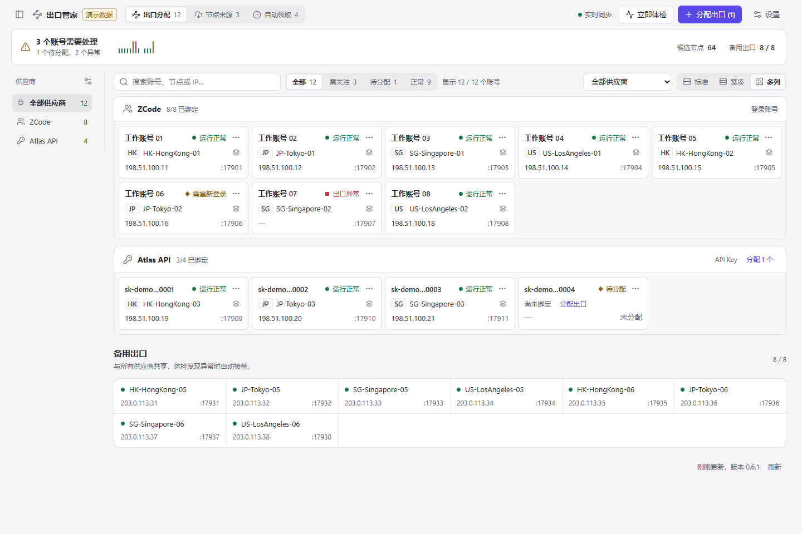

# MagpieProxy

**出口管家**：给 [magpie](https://github.com/yetone/magpie) 的每个供应商账号和 API Key 分配独立的代理出口。

<a href="#add-to-magpie">
  <picture>
    <source media="(prefers-color-scheme: dark)" srcset="https://usemagpie.ai/img/add-to-magpie-light.svg">
    
  </picture>
</a>

MagpieProxy 是一个 magpie 插件，在 magpie 里显示为「出口管家」。它使用 magpie 官方的插件页、设置面板和供应商菜单，另外提供独立的浏览器工作台，并支持[单 Key 多出口](#单-key-多出口)。安装不需要修改、重新编译或替换 magpie 主程序。

> **English** · MagpieProxy is a [magpie](https://github.com/yetone/magpie) plugin that gives each provider account or API key its own proxy exit: per-account mihomo SOCKS5 ports with exit-IP dedup, several exits behind one key, subscription import, health checks with spare failover, and a local API. Add it with `magpie plugin add github:OddlyLabs/MagpieProxy`. The documentation is in Chinese.

[快速开始](https://github.com/OddlyLabs/MagpieProxy/blob/main/QUICKSTART.md) · [配置与数据](https://github.com/OddlyLabs/MagpieProxy/blob/main/docs/configuration.md) · [本机 API](https://github.com/OddlyLabs/MagpieProxy/blob/main/docs/api.md) · [验证记录](https://github.com/OddlyLabs/MagpieProxy/blob/main/docs/VALIDATION.md) · [更新记录](https://github.com/OddlyLabs/MagpieProxy/blob/main/CHANGELOG.md) · [下载](https://github.com/OddlyLabs/MagpieProxy/releases/latest)



## Add to magpie

一条命令添加，不需要下载和解压：

```sh
magpie plugin add github:OddlyLabs/MagpieProxy
```

也可以在 magpie 窗口里操作：打开 **插件** 页，点 **添加插件**，在「已有想装的？」输入框里填入 `github:OddlyLabs/MagpieProxy`，点 **安装**。

添加后从导航栏的 **插件 → 出口管家** 进入；看不到入口时刷新 magpie 窗口。magpie 用自带的 Bun 拉取本仓库，不运行安装脚本，不需要另装 Node.js，也不需要 `npm install`。第一次添加插件时 magpie 会先下载 Bun。

| 操作 | 做法 |
| --- | --- |
| 更新 | 仓库有新提交时，magpie 的插件页会提示更新；也可以运行 `magpie plugin update`。 |
| 停在某个版本 | 添加时带上版本标签：`magpie plugin add github:OddlyLabs/MagpieProxy#v1.1.0`。 |
| 停用 / 启用 | `magpie plugin off magpie-zcode-egress`、`magpie plugin on magpie-zcode-egress`。 |
| 移除 | `magpie plugin rm magpie-zcode-egress`。 |

停用或移除插件不会删除运行数据，也不会停止已经在运行的后台和出口，账号上已绑定的代理地址同样保留。想让账号恢复原来的连接方式，先在工作台里解绑，再移除插件。

> [!NOTE]
> magpie 官方的 [Add to magpie 导入链接](https://usemagpie.ai/docs/zh/import)（`magpie://import…` 和 `usemagpie.ai/import#…`）目前只能添加模型供应商，不能安装插件。所以上面的按钮指向这一节，由这条命令完成添加。

## Windows 安装包

想要桌面快捷方式和一键诊断，或者不方便使用命令行时，可以改用安装包。从 [Releases](https://github.com/OddlyLabs/MagpieProxy/releases/latest) 下载 `MagpieProxy-1.1.0.zip`，完整解压后双击目录中的 **Install.cmd**。只复制目录不会完成插件注册。

安装器会找到正在使用的 magpie；找不到时会让你选择 EXE。随后将插件复制到该 magpie 数据目录中的 `local-plugins/magpie-zcode-egress`，完成注册、启用、后台启动和检查，最后打开浏览器面板。不需要管理员权限，优先复用 magpie 自带的 Bun，无需另装 Node.js。

magpie 已打开时，安装完成后刷新窗口。可以为固定安装目录中的 `Open.cmd` 创建桌面快捷方式；初次解压的目录可以移走。`Diagnose.cmd` 检查插件文件、注册、启用、后台状态及目录，并保存不包含账号密钥或订阅的 `diagnostics.txt`。

便携版、非默认目录和中文／空格路径均通过参数传递处理。需要手动指定程序时：

```powershell
powershell -NoProfile -ExecutionPolicy Bypass -File .\install.ps1 -MagpiePath 'D:\软件\magpie\magpie.exe'
```

`-InstallDir` 可指定插件目录；`-NoBrowser` 跳过自动打开浏览器。脚本仅在本次 PowerShell 进程中使用执行策略参数，不修改系统执行策略。

**两种安装方式选一种即可。** 它们使用同一份运行数据，换用另一种方式时账号绑定、订阅和设置都会保留。两种都装了的话，magpie 里会出现两个「出口管家」：运行 `magpie plugin` 查看列表，用 `magpie plugin rm <来源>` 移除其中一份。

## macOS / Linux

推荐使用上面的 [Add to magpie](#add-to-magpie)。也可以把安装包或本仓库放到长期保留的位置，然后运行：

```sh
./install.sh
# 后续打开工作台
./open.sh
```

`MAGPIE_EXE` 可以指定 magpie 的完整路径。也可以在 magpie 的「添加插件」里选择包含 `package.json` 的目录，或使用官方命令：

```sh
magpie plugin add /absolute/path/to/MagpieProxy
```

按目录添加的安装方式需要保留原目录。普通用户不需要运行 `npm install` 或构建前端。

## 打开出口管家

| 入口 | 位置 |
| --- | --- |
| magpie 插件页 | 导航栏底部的「插件 → 出口管家」，必要时向下滚动；顶部导航布局也使用原生插件入口。 |
| 设置面板 | 「设置 → 插件」中的出口管家面板，点击「在设置中打开工作台」。 |
| 供应商菜单 | 供应商菜单中的「打开出口管家」，直接选择对应供应商。 |
| 浏览器工作台 | 双击插件目录中的 `Open.cmd`（macOS / Linux 运行 `./open.sh`）；它会启动或复用后台并打开实际端口。 |

用 Add to magpie 添加时，插件目录是 magpie 数据目录下的 `plugins/node_modules/magpie-zcode-egress`；`magpie data` 会显示数据目录的位置。

## 环境要求

- **magpie**：建议最新版。插件所用页面、服务、面板和菜单接口在 v0.1.4174 已具备；已在未修改的 v0.1.4245 和 v0.1.4324 上验证。
- **运行时**：magpie 自带的 Bun；单独用 Node.js 启动时需要 **Node.js 22+**。
- **系统与内核**：实现 Windows、macOS、Linux 的 x64 / ARM64 路径和内核选择。Windows / macOS 的自动模式使用独立 mihomo；Linux 支持独立内核和 Docker Compose。
- **下载**：首次运行插件时可能由 magpie 下载 Bun；首次分配时下载固定的 mihomo **v1.19.34** 并核对发布方 SHA-256。Windows 使用 ZIP 和 `.exe`，Unix 使用 gzip；无需系统 `gzip`。下载镜像可以在设置中指定。
- **自动领取**：需要 Chrome / Edge。Windows 和 macOS 直接使用本机浏览器；无桌面的 Linux 需要 `xvfb-run`。关闭领取不影响出口管理。

普通安装无需 `curl`、`flock`、`sudo` 或 Docker。只有继续使用 `/opt/zcode-egress` 的 Linux 旧 cron 部署时，才额外使用原来的 `flock` 锁。Docker 后端依赖 Linux host 网络，优先使用当前用户的 Docker 权限，必要时尝试 `sudo -n`。

各系统上实际验证过什么、还有哪些没有实机验证，见[验证记录](https://github.com/OddlyLabs/MagpieProxy/blob/main/docs/VALIDATION.md)。

## 首次使用

1. 在工作台的 **设置 → 供应商** 中选择需要管理的供应商。
2. 在 **节点来源** 导入 Clash YAML 订阅、SOCKS5 地址或 Clash 节点片段。
3. 返回 **出口分配**，为未绑定账号分配出口。选择单个供应商时，分配只作用于该范围。
4. 检查出口 IP、节点延迟和本机 SOCKS5 地址；按需调整体检、备用节点及领取计划。

`autoAssignNew` 和 `claimEnabled` 默认开启，可在工作台中关闭。设置的「连接与维护」页显示运行方式、浏览器状态和实际数据目录。

## 功能与行为

| 功能 | 行为 |
| --- | --- |
| 多供应商 | 通过白名单管理登录账号和 API Key，使用共享节点来源与备用池。 |
| 独立绑定 | 保存「供应商 / 账号 → SOCKS5 端口 → 节点」，新分配保留已有绑定，按实际观测的出口 IP 去重。 |
| 节点来源 | 多个订阅分别更新和移除，更新失败保留上次缓存；支持手动号池。 |
| 单 Key 多出口 | 一个账号或 API Key 挂多个出口（默认最多 8 个，上限可在设置中调到 64），由本机入口端口分流；magpie 里仍只有一条账号记录。见[下文](#单-key-多出口)。 |
| 健康检查 | 故障出口切换备用；全部主出口失联时暂停换绑，保留故障记录。 |
| 节点详情 | 展示实际 TLS 延迟、总耗时、IP、来源和时间；单节点或最多 20 个节点批量测试。 |
| 工作台 | 标准、紧凑、多列三种视图，组合筛选、供应商快捷导航、明暗主题和窄屏布局。 |
| ZCode 领取 | 在北京时间计划窗口内尝试领取，使用该账号的出口。 |
| 本机 API | 查询供应商和绑定，以及分配、绑定、解绑、设置出口数量；请求 ID 去重。 |

绑定只修改 magpie 的 `accountProxies`，保留其它供应商配置，并由 magpie 热加载。复制的 `socks5://127.0.0.1:<port>` 指向 **magpie 所在的电脑**；出口公网 IP 只用于识别，不能当作代理连接地址。

节点延迟测量目标是 ZCode API。HTTP 401 表示目标可以到达，不代表账号认证成功或有可用额度。IP 去重使用最近一次实际观测，节点的公网地址之后仍可能改变。自动领取依赖第三方活动、认证和浏览器接口。

## 单 Key 多出口

magpie 的每个账号只能填一个代理地址，同一个 Key 也不能重复添加。出口管家不改 magpie：它让 magpie 的 `accountProxies` 指向一个本机 **入口端口**，入口后面是 mihomo 的负载均衡组，成员就是这个账号的多个出口。

```text
magpie 账号 ──▶ socks5://127.0.0.1:<入口>  ──▶  出口 A（节点 1，IP 1）
                    （分流策略）           ├─▶  出口 B（节点 2，IP 2）
                                          └─▶  出口 C（节点 3，IP 3）
```

每个已绑定的账号行上都有「多出口」按钮，点开后在「出口数量」里填想要的数量并应用；改回 1 就恢复成普通的单出口绑定。默认每个账号最多 8 个出口，需要更多时在「设置 → 体检与备用 → 单账号出口上限」里调整（2–64）。每多一个出口会多占用一个节点和一个本地端口。命令行和 API 也可以设置：

```sh
node egress-cli.mjs exits <供应商> <账号> 3 --strategy round-robin
```

| 策略 | 行为 |
| --- | --- |
| `round-robin`（默认） | 每个**新连接**换下一个出口。复用同一条连接的连续请求仍走同一个出口。 |
| `consistent-hashing` | 同一个目标域名固定走同一个出口，该出口故障时自动换到其它出口。一个 Key 只访问一个 API 域名时，效果是「固定出口 + 自动故障转移」。 |
| `sticky-sessions` | 同一来源访问同一目标时在一段时间内保持同一个出口。 |

每个出口都是一条普通的分配记录：出口 IP 互不重复，各自参与体检，出问题时单独换到备用节点；也可以在详情里只更换其中一个出口的节点。出口被判定故障后，入口会自动绕开它，客户端请求不受影响。

使用前需要了解：

- 每增加一个出口就多占用一个节点和一个出口 IP；可用节点不足时只会加到实际可用的数量，并在结果中说明。
- 入口组每 30 秒通过各出口访问 `https://www.gstatic.com/generate_204` 判断成员是否存活。所有出口都访问不到这个地址时，入口会退化为只使用第一个出口。
- ZCode 自动领取始终使用该账号的主出口，不经过入口分流。
- 多出口不会绕过供应商对单个 Key 的限额或风控；是否适合让一个 Key 同时从多个 IP 发出请求，需要按供应商的规则自行判断。

## 升级与排错

- **Add to magpie**：在 magpie 插件页点更新，或运行 `magpie plugin update`。
- **Windows 安装包**：解压新版后再次运行 `Install.cmd`。安装器遇到正在执行的任务会停止升级并说明原因；正常升级保留运行数据、备份旧运行文件，并停用同一插件的旧目录副本。已安装的目录可以重复注册和修复。
- **macOS / Linux 目录安装**：将新版文件放回原插件目录，再运行 `install.sh`。

后台按代码版本识别旧实例；有任务时等待用户稍后重试，空闲时接管。不需要重启 magpie 网关。

遇到问题先运行 `Diagnose.cmd`，或在插件目录中运行 `node manage.mjs doctor`：

| 现象 | 处理 |
| --- | --- |
| 复制后任何界面都没有入口 | 复制本身不是安装。用 [Add to magpie](#add-to-magpie) 添加，或运行 `Install.cmd`，然后确认注册和启用。 |
| 插件已列出但导航里看不到 | 刷新 magpie，向下滚动到插件分组；也可使用设置面板或 `Open.cmd`。 |
| 出现两个「出口管家」 | 两种安装方式都用了。运行 `magpie plugin` 查看列表，移除其中一份。 |
| 后台未启动或端口改变 | 运行 `Open.cmd`，它使用经过身份检查的实际服务端口。 |
| mihomo 下载失败 | 在设置中指定可用下载镜像，或手动将对应内核放到诊断显示的 `baseDir/bin/`。 |
| 自动领取浏览器未就绪 | 安装 Chrome / Edge，或用 `ZCODE_CHROME_PATH` 指定路径；Linux 检查图形环境。 |
| 从 0.6.x 使用过宿主补丁 | 新版插件无需补丁；官方 magpie 可以直接安装本版，旧宿主增强导航只作为兼容路径保留。 |

运行数据、备份和日志的具体位置见[配置与数据](https://github.com/OddlyLabs/MagpieProxy/blob/main/docs/configuration.md)。后台只监听本机，浏览器沙箱的 API 请求使用页面会话凭证；普通本机 API 仍按本机进程可信的方式提供管理能力，不提供远程用户账号系统。

## 名称说明

| 名称 | 用在哪里 |
| --- | --- |
| MagpieProxy | 项目和仓库的名字，也用于发布文件（`MagpieProxy-<版本>.zip`）。 |
| 出口管家 / Egress Manager | magpie 里的页面、设置面板和供应商菜单显示的名字。 |
| `magpie-zcode-egress` | 包名，也是插件目录和数据目录的名字，`magpie plugin on / off / rm` 用它指代本插件。升级和已有数据都靠它识别，所以没有随项目改名。 |

## 开发与验证

```sh
npm ci
npm run check
npm test
npm run dev
```

打开 <http://127.0.0.1:4177> 查看虚构数据预览，支持 `?theme=dark` 和 `?scenario=empty`、`stale`、`error`、`large`、`providers`、`exits`（单 Key 多出口）、`waiting`（后台尚未返回数据的首屏）。

```sh
npx playwright install chromium webkit
npm run test:ui
# 用 magpie 使用的 Bun 验证网络和后台
TEST_RUNTIME=/path/to/bun node --test test/socks.test.mjs test/server.test.mjs
# 生成安装 ZIP、npm 包、源码 ZIP 和校验清单
npm run release
```

代码入口：`index.mjs` 注册宿主服务；`server.mjs` 调度任务和提供 API；`manage.mjs` 管理本机工作台；`page/entry.html` 接入官方插件页，`page/index.html` 提供界面。`integrations/magpie/` 是旧版增强导航的历史源码，不参与 1.0 之后的安装。

用 Add to magpie 添加的用户跟随 `main` 分支更新，所以 `main` 上的每次提交都应当可以直接使用。当前进展和后续事项记录在 [HANDOFF.md](https://github.com/OddlyLabs/MagpieProxy/blob/main/HANDOFF.md)。

测试使用独立目录；手动启动服务前请按[开发隔离](https://github.com/OddlyLabs/MagpieProxy/blob/main/docs/configuration.md#开发隔离)设置环境变量。提交或分享时不要包含 `page/data.js`、`installation.json`、日志、账号配置、订阅和运行备份。

## 许可证

项目采用 [MIT License](https://github.com/OddlyLabs/MagpieProxy/blob/main/LICENSE)。感谢 magpie、mihomo、Lucide、yaml 和 fflate。第三方代码保留各自许可证，见[第三方许可说明](https://github.com/OddlyLabs/MagpieProxy/blob/main/THIRD_PARTY_NOTICES.md)。
